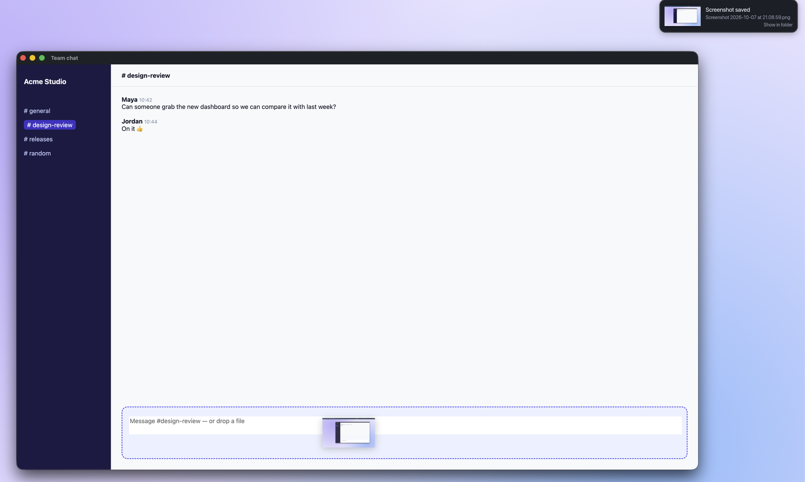
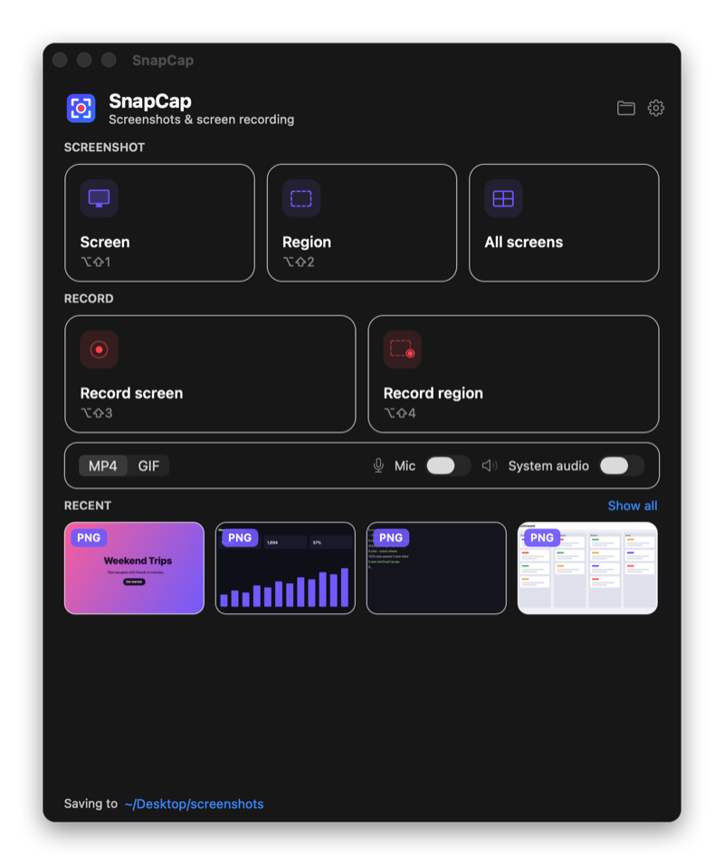
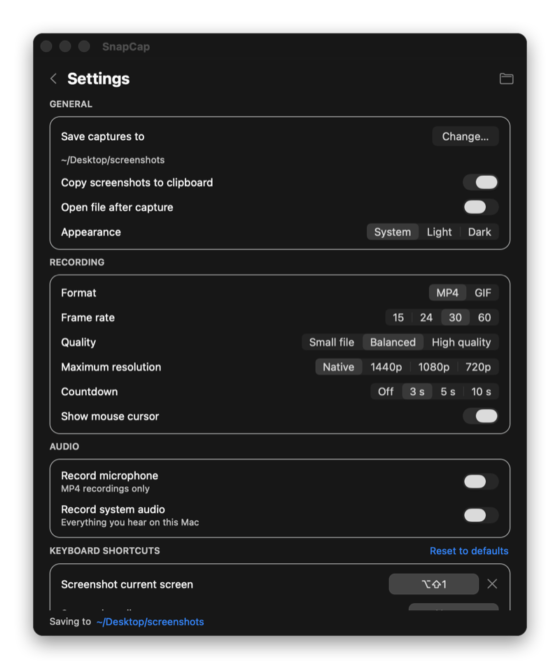
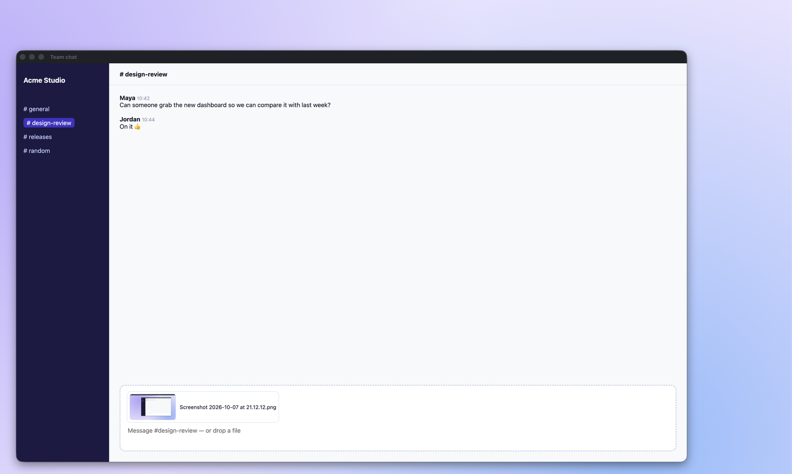

# SnapCap

A small, fast screenshot and screen-recording app for **macOS, Windows and Ubuntu**.
It's a small native app: on macOS it's written in C++ with an AppKit UI (about 2 MB), and
the Windows and Linux builds come from the original Rust version. There's nothing else to
install: no ffmpeg, no runtimes and no redistributables.

Captures are saved to **`~/Desktop/screenshots`** by default. The folder is created
automatically, and you can change it in Settings.



*Take a screenshot, then drag the notice straight into a chat, a browser tab, a text box, a
folder or an app, the same way you drag the macOS screenshot thumbnail.*

## Download

Grab the latest build from the [Releases page](../../releases/latest):

| OS | File |
|---|---|
| macOS 13.3+ (Apple silicon and Intel) | `SnapCap-<version>-macos-universal.dmg` |
| Windows 10/11 | `SnapCap-<version>-windows-x64.zip` |
| Ubuntu 24.04+ | `snapcap_<version>_amd64.deb` or `snapcap-<version>-linux-amd64.tar.gz` |

The builds aren't signed with a paid Apple or Microsoft certificate yet, so the first launch
needs one extra step:

- **macOS:** drag SnapCap to Applications and open it. If macOS says it can't verify the
  developer, open *System Settings → Privacy & Security* and click **Open Anyway**. Or run
  `xattr -dr com.apple.quarantine /Applications/SnapCap.app` once.
- **Windows:** if SmartScreen shows "Windows protected your PC", click **More info → Run anyway**.

## What it does

- **Screenshots:** the screen under the mouse, all screens stitched together, or a region.
  - For a region, SnapCap freezes the screen, then you drag a box over it. A magnifier
    shows exact pixels, and the selection size is shown as you drag.
  - Screenshots are saved as PNG and also copied to the clipboard (you can turn this off).
- **Recordings:** a whole screen or a region, saved as **MP4** (H.264 + AAC) or **GIF**.
  - **Audio:** microphone and/or system audio (MP4 only).
  - **Controls:** pause/resume, a 3-second countdown, and a floating control bar. The
    recorded area is outlined.
  - On macOS and Windows, SnapCap's own windows (the bar, the outline and notices) never show
    up in your recordings. On Linux the outline sits just outside the recorded area, but the
    control bar will appear in full-screen recordings.
- **Lives in the menu bar / system tray.** Closing the window keeps SnapCap running.
  - After each capture, a notice with a thumbnail appears in the bottom-right corner of the
    screen you captured, just above the Dock. Click it to open the file.
- **Drag and drop captures anywhere.** Drag the notice that appears after a capture and drop
  it wherever a file can go:
  - a chat (Discord, Slack, Teams), an email, or any upload area or text box in a browser
  - a Finder or Explorer folder, or the desktop
  - an app window or a Dock icon (for example Preview, Photoshop or Figma)

  The file is copied, so the original stays in your captures folder. When the drop lands, the
  notice goes away, like the macOS screenshot thumbnail. Thumbnails under *Recent* in the main
  window can be dragged out the same way. Works on macOS and Windows.
- **Global keyboard shortcuts**, configurable under *Settings → Keyboard shortcuts*:
  click a shortcut and press the new keys.
  - Esc cancels, Backspace removes the shortcut.
  - Conflicts with other actions, with other apps, or with the OS's own screenshot keys
    are flagged as you set them.
- **Command line:** `snapcap --shot region`, `--record screen`, `--record stop` and so on.
  If SnapCap is already running, the command is passed to that instance. This lets you
  bind keys in any desktop environment.

### Screenshots

The macOS app:

| Main window | Settings |
|---|---|
|  |  |

After dropping the notice into a chat's message box, the screenshot is attached and the notice is gone:



### Default shortcuts

| Action | macOS | Windows / Linux |
|---|---|---|
| Screenshot current screen | ⌥⇧1 | Alt+Shift+1 |
| Screenshot region | ⌥⇧2 | Alt+Shift+2 |
| Record current screen | ⌥⇧3 | Alt+Shift+3 |
| Record region | ⌥⇧4 | Alt+Shift+4 |
| Pause / resume recording | ⌥⇧9 | Alt+Shift+9 |
| Stop recording | ⌥⇧0 | Alt+Shift+0 |

These avoid the system screenshot keys (⌘⇧3/4/5 on macOS, Win+Shift+S on Windows).

### In the region selector

| Input | Effect |
|---|---|
| Drag | Select an area |
| Click | Capture the whole screen |
| Enter | Confirm |
| Esc | Cancel |

When recording a region, you can move or resize the selection before pressing
**Start recording**.

## Building

SnapCap is C++23 built with CMake. Each script below writes its output to `dist/`.

| OS | Command | Output | Build requirements |
|---|---|---|---|
| macOS 13.3+ | `scripts/bundle-macos.sh` (add `--universal` for Intel + Apple silicon) | `SnapCap.app` and a DMG | Xcode Command Line Tools, CMake 3.24+, Ninja (`brew install cmake ninja`) |
| Windows 10/11 | `powershell archive\rust\scripts\build-windows.ps1` | `SnapCap.exe` and a zip | The archived Rust app: Rust, Visual Studio Build Tools (C++), [NASM](https://nasm.us) |
| Ubuntu 24.04+ | `archive/rust/scripts/build-linux.sh --install-deps` | `.deb` and `.tar.gz` | The archived Rust app: the script installs everything it needs with apt |

For development on macOS:

```sh
cmake --preset debug && cmake --build --preset debug   # build/debug/SnapCap.app
ctest --preset debug                                   # unit and macOS integration tests
cmake --preset asan && cmake --build --preset asan && ctest --preset asan   # with sanitizers
scripts/smoke-macos.sh                                 # end-to-end: screenshots and a recording
```

macOS ties the Screen Recording permission to the app's signature. Ad hoc signing (the
default) changes with every build, so for day-to-day development configure with a stable
identity, e.g. `cmake --preset debug -DSNAPCAP_SIGN_IDENTITY="Apple Development: …"`.
Logs go to `~/Library/Logs/SnapCap/snapcap.log`.

On every push, `.github/workflows/build.yml` tests the macOS app under AddressSanitizer,
UndefinedBehaviorSanitizer and ThreadSanitizer, and packages all three operating systems.
Pushing a tag such as `v0.2.0` also publishes a GitHub release with the macOS DMG, the
Windows zip and the Linux `.deb`/`.tar.gz` attached:

```sh
git tag v0.2.0 && git push origin v0.2.0
```

### The Rust version

SnapCap was first written in Rust. That version lives on in [`archive/rust/`](archive/rust)
and still builds there (`cd archive/rust && cargo build`). Windows and Linux releases come
from it until their C++ backends are finished; macOS releases come from the C++ app.

## Platform notes

- **macOS:**
  - The first capture asks for *Screen & System Audio Recording* permission. Enable
    SnapCap in System Settings, then reopen it. The app shows a banner with a button
    until permission is granted.
  - Recording uses ScreenCaptureKit, which does the cropping and scaling on the GPU and
    captures system audio. AVFoundation encodes H.264 on the hardware encoder and writes the MP4.
  - The microphone asks for permission the first time you record with it.
  - Dragging a capture out starts a standard AppKit file drag (a file URL with the image as the
    drag preview). Any app that accepts files from Finder accepts it.
- **Windows:**
  - Recording uses DXGI desktop duplication. SnapCap draws the mouse cursor into each frame itself.
  - System audio uses WASAPI loopback.
  - SnapCap's windows are kept out of captures with `WDA_EXCLUDEFROMCAPTURE`.
  - Dragging a capture out uses the shell's own drag (`SHDoDragDrop`), so it behaves exactly
    like dragging the file from Explorer.
- **Ubuntu / Linux:**
  - Works on X11 and Wayland. On Wayland, screen capture goes through the desktop portal,
    and GNOME asks for permission.
  - Wayland doesn't let apps register global shortcuts. Bind the `snapcap --shot …`
    commands under *Settings → Keyboard → Custom Shortcuts* instead. The exact commands
    are shown in SnapCap's settings.
  - The tray uses the StatusNotifierItem protocol, which Ubuntu supports out of the box.
  - System audio is recorded from the PulseAudio/PipeWire "Monitor" source.
  - On X11, SnapCap draws the mouse cursor into recordings itself (via XFixes). On Wayland,
    whether the cursor appears is up to the desktop portal.
  - Dragging captures out of SnapCap isn't supported on Linux yet. Use *Show in folder* and
    drag the file from your file manager instead.

## Performance

- The app uses no CPU while idle: windows only redraw on input or events, and nothing is polled.
- **macOS:**
  - ScreenCaptureKit crops and scales on the GPU and only delivers frames when the screen
    changes. H.264 runs on the hardware encoder; recording 4K uses a small fraction of one core.
  - If the encoder falls behind, frames are dropped rather than buffered. Timestamps are
    variable-frame-rate, so audio stays in sync even when frames are dropped.
  - Screenshots are PNG-compressed on all cores: a 5K screenshot encodes in about 40 ms.
  - Output is capped at 3840×2160, the H.264 limit.
- **GIFs** stay small:
  - Each frame stores only the rectangle that changed, and unchanged pixels are transparent.
  - Flat UI colours are stored exactly rather than approximated.
- **Windows and Linux** (the archived Rust app) encode with OpenH264 in software and default
  to a 1440p maximum; see [`archive/rust`](archive/rust).

## Project layout

```
core/              portable C++: the app state machine, settings, shortcuts, geometry,
                   region selection, recording clock, audio mixer, PNG and GIF encoders,
                   icons. No OS APIs; fully unit-tested.
platform/macos/    AppKit UI (main window, region overlay, recording bar, notice, menu bar),
                   ScreenCaptureKit capture and recording, global hotkeys
platform/posix/    single-instance command forwarding over a Unix socket
tests/             core unit tests (doctest) and macOS integration tests
archive/rust/      the original Rust app (Windows and Linux builds)
packaging/         Info.plist, entitlements, .desktop file; Windows resources live in assets/windows
docs/screenshots/  images used in this README
scripts/           packaging and smoke-test scripts
```

## License

SnapCap is free software, licensed under the
[GNU General Public License v3.0 or later](LICENSE).

SnapCap compiles in the Fraunhofer FDK AAC encoder for MP4 audio. The FDK AAC licence isn't
compatible with the GPL on its own, so SnapCap's licence includes an
[additional permission](LICENSE-EXCEPTION) (GPLv3 section 7) that allows the two to be
distributed together.

### Patents

H.264 and AAC are patented formats. SnapCap compiles OpenH264 and FDK-AAC from source.
Cisco's free H.264 patent licence only covers Cisco's own prebuilt binaries, and the FDK AAC
licence grants no patent rights. That's fine for personal and internal use, but commercial
distribution needs a licensing review. GIF output is unaffected either way.
